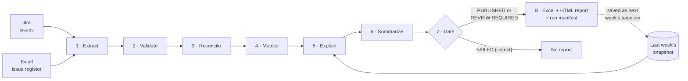

# imo-trail — Issue Management Office reporting automation

A weekly report pipeline for an **Issue Management Office (IMO)** on a fund
**transfer-agency modernization program**. It is built the way a reporting process
should be maintained: rerunnable, testable, self-checking, and easy to troubleshoot.
Every number in the report can be traced back to the issues behind it. That is the "trail".

> All data is synthetic and generated by `scripts/generate_sample_data.py`.
> No company, client or employee data is used.

## The problem

Workstreams log and remediate issues in **Jira**. The IMO keeps an **Excel issue
register** for the steering committee, with severity, escalation level, exec owner
and the regulatory/client-impact flag. Every week someone has to:

1. pull both,
2. clean up the Excel (re-pasted rows, dates typed as text, inconsistent statuses),
3. work out where the register and Jira disagree,
4. build the KPIs and the workstream/aging views,
5. answer *"why did overdue go down?"* and *"which dates moved?"*,
6. write the summary for SteerCo.

Done by hand, that takes hours, and the errors get to SteerCo before they get to you.

## How it works



Each week the pipeline reads both sources, checks and cross-checks them, calculates the
KPIs, explains how they changed since the previous week, and only then decides whether the
report can go out. A detailed diagram with each decision point explained is in
**[docs/ARCHITECTURE.md](docs/ARCHITECTURE.md)**.

| Step | What happens |
|---|---|
| **Extract** | Jira via REST (`/rest/api/3/search/jql`, paginated) or a JSON export. Excel header row auto-detected (title rows are fine). Every coercion is logged. |
| **Validate** | 15+ checks with a severity policy: exact duplicate rows auto-removed (**WARN**, with Excel row numbers); text dates parsed (**WARN**); casing normalized (**INFO**); missing target dates, unknown values, impossible dates (**ERROR**). A renamed header is a **BLOCKER**: the run stops with a clear message. |
| **Reconcile** | Register vs Jira: key typos, Critical/High issues missing from the register, status drift in both directions, severity mismatch, stale target dates, workstream mismatch. Each break comes with a suggested action. |
| **Metrics** | Every KPI is defined once, as data (`imo_trail/metrics.py`). Open, Critical/High, overdue, past-SLA, >90 days, raised/closed, net burn, SteerCo escalations, regulatory. Plus workstream and aging heat-map tables. |
| **Explain** | The **variance explainer** says *why* each KPI moved since last week, record by record. It separates **time passing** from **data changes**, and checks that the drivers add up to the delta. A **target-date slip** report lists every issue whose date moved out. |
| **Summarize** | Deterministic summary by default. `--ai` drafts it with Claude using **aggregates only**, then **checks every number** against the facts. Any ungrounded number, error or refusal falls back to the template. |
| **Gate** | `PUBLISHED`, `REVIEW REQUIRED` (errors shown in a banner), or `--strict` → `FAILED` with no outputs. |
| **Render** | Formatted Excel (8 tabs, filters, frozen headers, conditional fills) and a self-contained HTML page. `run_manifest.json` records input hashes, row counts, findings, timings and the git commit. |

## Example: what the explainer catches

```
Overdue (past target date): 24 -> 21 (-3)
  status In Remediation -> Closed      -2
  time passed (crossed date threshold) +2
  status Pending Validation -> Closed  -1
  target date moved later              -1   <- not fixed, just re-baselined
  target date removed                  -1   <- data-quality problem hiding an overdue Critical/High
```

A point-in-time report would show "overdue improved by 3". The explainer shows that
two of those three were date changes, not fixes.

## Run it

```bash
make setup      # venv + deps
make demo       # runs 2026-11-06 (baseline) then 2026-11-13
make test       # 13 tests, incl. "every planted defect is caught"
```

```bash
.venv/bin/python -m imo_trail run --asof 2026-11-13              # build the report
.venv/bin/python -m imo_trail explain --asof 2026-11-13 overdue  # why did one KPI move?
.venv/bin/python -m imo_trail run --asof 2026-11-13 --ai         # + guarded AI summary
.venv/bin/python -m imo_trail fetch-jira --asof 2026-11-20       # live Jira pull
```

`--ai` needs `ANTHROPIC_API_KEY`. `fetch-jira` needs `JIRA_BASE_URL`, `JIRA_EMAIL`
and `JIRA_API_TOKEN`. Without them the pipeline still runs on the sample data.

## Layout

```
imo_trail/
  config.py        business rules: SLAs, statuses, field IDs, column mappings
  sources.py       Jira + Excel extract (header detection, coercion log, live Jira pull)
  quality.py       data-quality checks + severity policy
  reconcile.py     register vs Jira
  metrics.py       KPI definitions (one place) + breakdown tables
  detective.py     week-over-week variance explainer + target-date slips
  narrative.py     template summary + guarded AI summary
  pipeline.py      orchestration, snapshots, status gate, run manifest
  render_excel.py / render_html.py
scripts/generate_sample_data.py   synthetic data with planted, realistic defects
docs/ARCHITECTURE.md              detailed flow chart, explained step by step
docs/RUNBOOK.md                   how to run, troubleshoot and change it
tests/                            unit + end-to-end tests
```
