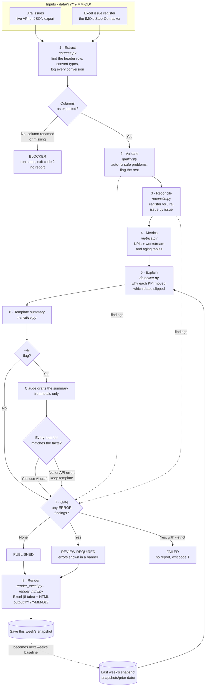

# How imo-trail works

This page walks through one weekly run, from the two input files to the published
report. The numbers in the examples come from the sample run for **2026-11-13**
(`make demo`).

## The full flow

Every run, including a `FAILED` one, also writes `run_manifest.json`: input file hashes,
row counts, finding counts, KPI values, timings and the git commit. If anyone asks
"which data produced this report?", the manifest answers it.

## How to read the chart

- **Rectangles** are steps that do work. Each names the file that does it.
- **Diamonds** are decisions. The run can take a different path at each one.
- **Cylinders** are saved data: last week's snapshot and this week's.
- **Dotted lines** carry information, not control. Validation and reconciliation don't
  stop the run when they find problems. They record **findings**, and the gate reads
  them at the end.

## Step by step

### 1 · Extract: read both sources without losing anything
Reads the Jira issues and the Excel register. The Excel often has title rows above the
real header, so the code finds the header row itself. Every value it has to convert,
such as a date typed as text, is logged rather than silently changed.

**First decision: are the columns what we expect?** If someone renamed "Target Date" to
"Due", every later number would be wrong. So the run stops here with a **BLOCKER** and a
clear message, instead of producing a report that looks fine but isn't.

### 2 · Validate: proofread the data
Runs 15+ checks. Each finding has a severity:

| Severity | Meaning | Example from the sample run |
|---|---|---|
| WARN | Safe to fix automatically, and the fix is logged | 3 duplicate rows removed (Excel rows 153–155) |
| INFO | Cosmetic | 2 statuses with stray spaces or casing normalized |
| ERROR | A reported number might be wrong, so a person must look | 1 open Critical/High issue with no target date |

### 3 · Reconcile: cross-check the two sources
Compares the register with Jira issue by issue, like matching a bank statement against
your own records. In the sample run it found:

- 2 issues **closed in the register but still open in Jira**
- 2 **Critical/High issues in Jira that are missing from the register**
- 2 **severity disagreements**
- 1 register row pointing to a **Jira key that doesn't exist** (probably a typo)

Each break comes with a suggested action, such as "add it before SteerCo".

### 4 · Metrics: count everything the same way every week
Calculates the KPIs (open, Critical/High, overdue, past SLA, older than 90 days, raised
vs closed, escalations) plus the workstream and aging tables. Each KPI is **defined once**
in `metrics.py`, so "overdue" means the same thing every week, whoever runs the report.

### 5 · Explain: say *why* each number moved
This step needs **last week's snapshot**, the cylinder feeding in from the side. It
compares the two weeks issue by issue and gives every change a cause:

| Issue | What happened | Effect on overdue |
|---|---|---|
| TAMI-1126, TAMI-1063, TAMI-1172 | Actually fixed and closed | −3 |
| TAMI-1043, TAMI-1231 | Deadline passed this week | +2 |
| TAMI-1175 | Target date pushed out 45 days | −1 |
| TAMI-1038 | Target date deleted | −1 |
| **Total** | | **24 → 21 (−3)** |

The drivers must add up to the total change, which the code checks. So "overdue improved
by 3" becomes "3 real fixes, 2 newly late, and 2 date changes that only look like
improvement". On the very first run there is no snapshot yet, so this step is skipped.

### 6 · Summarize: write it up, with a fact-check
The template summary is always built. With `--ai`, Claude also drafts one, but it only
sees **totals**, never raw issue records. Then **every number in the draft is checked**
against the real figures. If any number doesn't match, or the API call fails, the
template summary is used. The report always says which one it used.

### 7 · Gate: decide whether the report can go out
The gate reads every finding from steps 2 and 3:

- **PUBLISHED**: no errors, ready to send.
- **REVIEW REQUIRED**: errors exist. The report is still built, with a banner listing
  what to resolve. The sample run ended here because of the reconciliation breaks.
- **FAILED**: only with `--strict`. Errors mean no report at all, which suits a scheduled
  job where a wrong report is worse than none.

### 8 · Render: produce the report and remember this week
Writes the formatted Excel workbook (8 tabs) and a self-contained HTML page to
`output/YYYY-MM-DD/`. Then it saves this week's data as a **snapshot**, and the dotted
arrow loops back: next week, this snapshot is the baseline that step 5 compares against.
A `FAILED` run saves no snapshot, so bad data never becomes next week's baseline.
